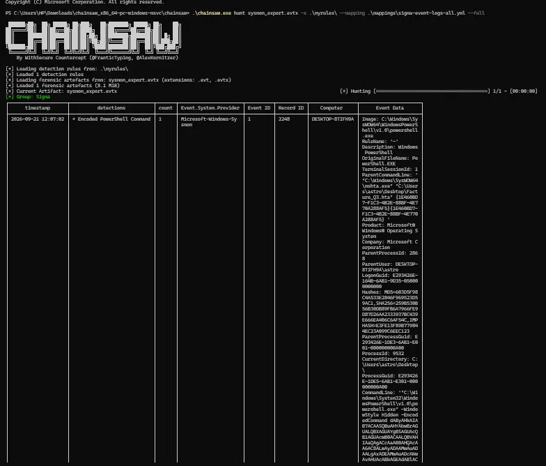
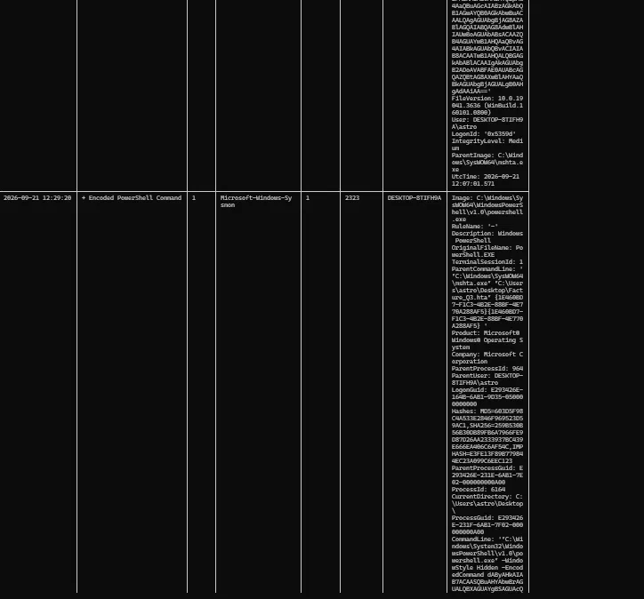
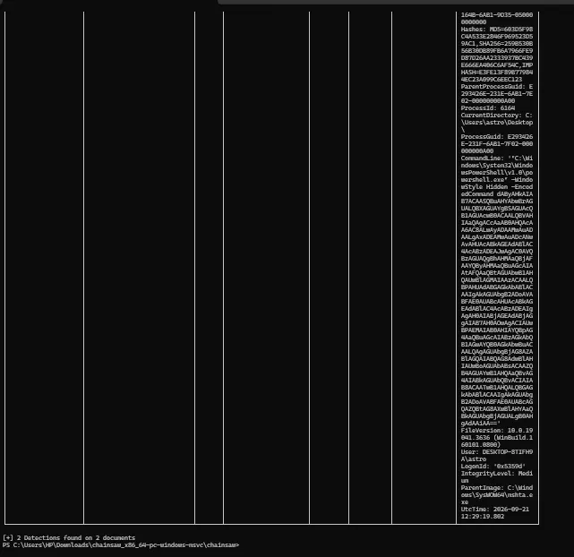

# Write a Sigma Detection Rule (Encoded PowerShell Command)

## Summary
Wrote a 9-line **Sigma** detection rule from scratch, targeting one specific attacker behaviour
(obfuscated PowerShell execution), then proved it actually fires — not against synthetic sample
data, but against a real Sysmon log containing a genuine encoded-PowerShell execution chain
captured in an earlier investigation.

## Tools used
- Sigma (vendor-agnostic YAML detection rule format)
- Chainsaw (WithSecure) — runs Sigma rules directly against `.evtx` event log exports, no SIEM
  required
- Sysmon — the log source the rule was tested against

## Step 1 — Pick one behaviour
Targeted **encoded PowerShell execution** (`-EncodedCommand` / `-enc`), a well-documented evasion
technique (MITRE ATT&CK **T1059.001**) attackers use to dodge simple string-matching on suspicious
keywords. One behaviour, one rule — never a catch-everything rule.

## Step 2 — Write the rule

```yaml
title: Encoded PowerShell Command
id: 11111111-2222-3333-4444-555555555555
status: test
description: Detects PowerShell execution using an encoded command
author: Mohamed
logsource:
  product: windows
  service: sysmon
  category: process_creation
detection:
  selection:
    Image|endswith: '\powershell.exe'
    CommandLine|contains:
      - '-enc'
      - '-encodedcommand'
  condition: selection
falsepositives:
  - Legitimate administrative PowerShell scripts
level: high
```

**Troubleshooting note worth keeping in the write-up:** a first draft of this rule without `id`,
`status`, or `service: sysmon` in the `logsource` loaded fine by the general Sigma spec but was
silently rejected by Chainsaw's loader (`No valid detection rules were found`). Chainsaw's Sigma
loader requires a valid `id` (UUID) and `status` field, and a `service: sysmon` logsource to match
its Sysmon event mapping correctly — a good example of a tool being stricter than the format it
implements.

## Step 3 — Convert it and prove it fires
Instead of standing up a full SIEM, ran the rule directly against a real forensic artefact with
**Chainsaw**, which loads Sigma rules and a field-mapping file and hunts them straight through an
`.evtx` export:

```
.\chainsaw.exe hunt sysmon_export.evtx -s .\myrules\ --mapping .\mappings\sigma-event-logs-all.yml --full
```

**Result: the rule fired on 2 real detections, found on 2 documents** — both the genuine
`mshta.exe → powershell.exe` encoded-command executions captured in an earlier investigation
(timestamps `2026-09-21 12:07:02` and `12:29:20`), each showing the full
`-WindowStyle Hidden -EncodedCommand` command line and the `mshta.exe` parent process. This isn't
a rule tested against a toy example — it's a rule that caught a real, previously-documented
execution chain on the first clean run.





## Step 4 — Hunt your own false positives
Being honest about what else would trigger this exact rule is what separates a usable detection
from a toy one:

| Will look malicious to this rule, but usually isn't | What to do about it |
|---|---|
| IT deployment tools (SCCM, Intune) that pass encoded commands | Their `ParentImage` is typically a known deployment agent, not a lure file opened from a user's Desktop — add a `filter` excluding known-good parent processes, baseline a quiet week first |
| Backup/monitoring agents using `-EncodedCommand` internally | Name the specific agent and its parent process as an explicit, documented exclusion |
| Your own admin work / testing this very rule | Documented here, not silently excluded — this detection's two hits are both from this project's own earlier `Facture_Q3.hta` simulation, not production noise |
| Scheduled tasks running encoded PowerShell at odd hours | Cross-check against the task scheduler before assuming malice from timing alone |

No exclusion filter was applied to the two real hits above, since neither matches a legitimate
case — both trace to a simulated lure file launched from a user's Desktop via `mshta.exe`, not an
IT or backup tool.


## What I learned
Getting "No valid detection rules were found" from a syntactically valid Sigma rule was the most
useful part of this project — it showed that Sigma is a *format*, and each backend (Chainsaw here,
a SIEM elsewhere) layers its own stricter requirements on top (a UUID `id`, a `service` field tied
to its field-mapping file). Running the rule against a real captured attack chain instead of
synthetic test data also made the false-positive analysis concrete rather than theoretical: I
could point to exactly which process, which parent, and which prior investigation each detection
traced back to.

---

